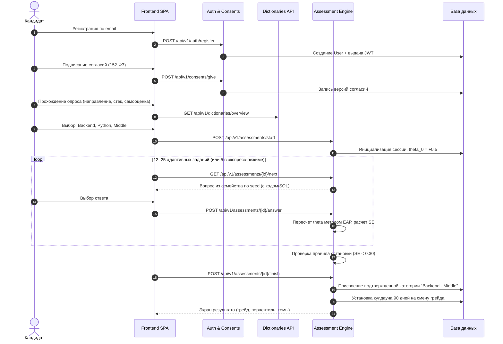
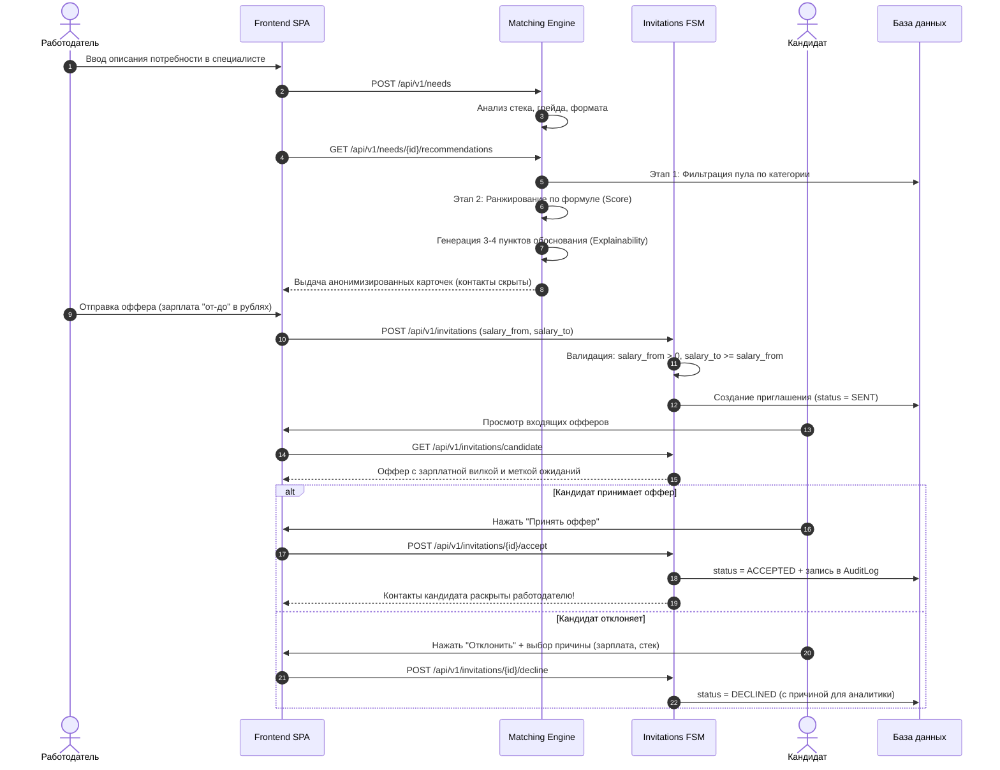
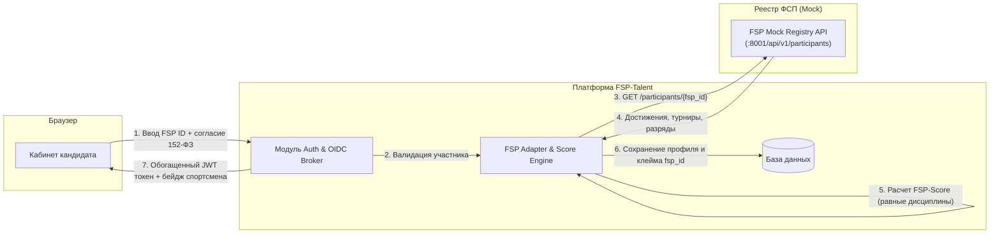

# Архитектурное руководство платформы FSP-Talent

Данный документ содержит исчерпывающее описание архитектурных решений, структурной декомпозиции и сквозных потоков данных цифровой платформы **FSP-Talent**, актуализированное в соответствии с решениями сессии **Q&A от 06.10.2026** (имеющими безусловный приоритет над ТЗ).

---

## 1. Архитектурная парадигма: Модульный монолит

Платформа спроектирована по принципу **модульного монолита (Modular Monolith)** на базе Python 3.12 и FastAPI. 

### Почему модульный монолит:
1. **Скорость и надежность в рамках хакатона:** Устраняет сетевые задержки, проблему распределенных транзакций и накладные расходы на сервисную сетку (Service Mesh), присущие микросервисам.
2. **Строгие доменные границы:** Кодовая база разделена на слабосвязанные модули (`backend/app/modules/*`). Модули взаимодействуют между собой через явные сервисные интерфейсы, а не через прямое вмешательство во внутренние структуры данных чужих контекстов.
3. **Готовность к микросервисному распилу:** При росте нагрузки любой модуль (например, `assessment` или `matching`) может быть легко вынесен в независимый микросервис без изменения внешнего контракта API.

```
┌────────────────────────────────────────────────────────────────────────┐
│                          FASTAPI APPLICATION                           │
│                                                                        │
│  ┌──────────────┐  ┌──────────────┐  ┌──────────────┐  ┌─────────────┐ │
│  │     auth     │  │   consents   │  │   profiles   │  │ dictionaries│ │
│  └──────┬───────┘  └──────┬───────┘  └──────┬───────┘  └──────┬──────┘ │
│         │                 │                 │                 │        │
│  ┌──────┴───────┐  ┌──────┴───────┐  ┌──────┴───────┐  ┌──────┴──────┐ │
│  │  assessment  │  │   matching   │  │  invitations │  │     fsp     │ │
│  │   (CAT/IRT)  │  │(2-stage rank)│  │ (FSM & 152-ФЗ│  │(Score/Mock) │ │
│  └──────────────┘  └──────────────┘  └──────────────┘  └─────────────┘ │
└────────────────────────────────────┬───────────────────────────────────┘
                                     │
           ┌─────────────────────────┴─────────────────────────┐
           ▼                                                   ▼
┌───────────────────────┐                           ┌────────────────────┐
│ PostgreSQL 16 + vector│                           │  Valkey 7.2 Cache  │
└───────────────────────┘                           └────────────────────┘
```

---

## 2. Слоистая структура модуля

Каждый доменный модуль в директории `backend/app/modules/<module_name>/` структурирован по классической трехслойной модели:

```
app/modules/<module_name>/
├── models.py       # Доменный слой: SQLAlchemy 2.0 декларативные модели
├── schemas.py      # Слой контрактов: Pydantic v2 схемы валидации (DTO)
├── service.py      # Слой бизнес-логики: чистые сервисные функции и FSM
└── router.py       # Транспортный слой: FastAPI эндпоинты с DI (Depends)
```

### Назначение слоев:
- **Транспортный слой (`router.py`):** Принимает HTTP-запросы, валидирует входные параметры через Pydantic, извлекает пользователя из JWT-токена (`get_current_user`), делегирует исполнение сервису и возвращает типизированный ответ.
- **Сервисный слой (`service.py`):** Содержит бизнес-правила (например, валидацию зарплатной вилки, проверку переходов конечного автомата, расчет информационной функции IRT). Не зависит от HTTP-фреймворка.
- **Доменный слой (`models.py`):** Описывает таблицы, первичные/внешние ключи, каскадные удаления и индексы.

---

## 3. Сквозные потоки данных (Data Flows)

### Поток 1: Путь кандидата (Онбординг → Тестирование → Присвоение категории)



---

### Поток 2: Поиск работодателя и выход на контакт с обязательной зарплатой



---

## 4. Архитектура безопасности и соответствие 152-ФЗ

1. **Раздельные согласия со строгим версионированием:**
   - Согласие на обработку персональных данных (`PERSONAL_DATA`, версия `1.0`).
   - Согласие на распространение данных профиля неопределенному кругу работодателей (`PROFILE_DISTRIBUTION`, ст. 10.1 152-ФЗ).
   - Согласие на запрос сведений из реестра ФСП (`FSP_DATA_EXCHANGE`, версия `1.0`).
   - При отзыве согласия на распространение профиль кандидата автоматически исключается из поисковой выдачи работодателей.

2. **Гарантия сокрытия контактных данных (Contact Anonymization):**
   - На уровне доменных моделей и Pydantic-сериализаторов персональные данные (`email`, `phone`, `telegram`, `first_name`, `last_name`) физически вырезаются из ответов на запросы работодателя (`CandidateProfileAnonymizedResponse`).
   - Единственное условие раскрытия контактов - переход приглашения в статус `ACCEPTED` (или прямой отклик кандидата на открытую вакансию).
   - Каждое раскрытие фиксируется в таблице `audit_log` с отметкой времени, ID пользователя и IP-адресом.

3. **Защита паролей и токенов:**
   - Хеширование паролей алгоритмом `bcrypt` с солью.
   - JWT токены с коротким временем жизни (Access) и ротацией Refresh токенов.
   - Унифицированная модель клеймов (`sub`, `email`, `role`, `fsp_id`) для бесшовной интеграции с Keycloak OIDC Identity Brokering.

---

## 5. Инфраструктурный профиль и соответствие стенду жюри

На установочной сессии Q&A были зафиксированы точные параметры тестового стенда экспертов:
- **Оперативная память:** 32–64 ГБ RAM;
- **Процессор:** порядка 8 ядер CPU (до 16);
- **GPU (видеокарта):** **ОТСУТСТВУЕТ**.

### Инфраструктурные решения платформы FSP-Talent:
1. **Отсутствие локальных GPU-зависимостей:**  
   Вся математика адаптивного тестирования (2PL IRT, EAP-интегрирование), эмбеддинги и формулы подбора работают исключительно на CPU с использованием оптимизированных библиотек `numpy` и `scipy`.
2. **Аутентификация:**  
   Платформа использует встроенный JWT-провайдер с эмуляцией FSP ID, а архитектура предусматривает возможность подключения к Keycloak по протоколу OIDC при промышленном внедрении.
3. **Легковесный состав контейнеров:**
   - `fsp-postgres`: PostgreSQL 16 + `pgvector` (~200 МБ RAM);
   - `fsp-valkey`: Valkey 7.2 (~30 МБ RAM);
   - `fsp-backend`: FastAPI на Python 3.12 (~150 МБ RAM);
   - `fsp-frontend`: Nginx Alpine (~20 МБ RAM);
   - `fsp-mock-registry`: FastAPI Mock API ФСП (~80 МБ RAM);
   - `fsp-mailpit`: Mailpit SMTP (~30 МБ RAM).  
   *Общее потребление RAM всего комплекса: менее 1 ГБ, что с огромным запасом укладывается в стенд жюри (32–64 ГБ).*
4. **Политика отказоустойчивости (Q&A п. 42, 175):**  
   Все контейнеры оснащены директивой `restart: unless-stopped` и healthcheck-проверками. В случае сбоя контейнер автоматически перезапускается без изменения зафиксированного состояния базы.

---

## 6. Архитектурная стратегия применения LLM

В соответствии с п. 30, 113–118 Q&A применение генеративных языковых моделей разрешено со следующими ограничениями:
1. **Приоритет отечественных моделей:**  
   Для соблюдения 152-ФЗ и исключения трансграничной передачи ПДн архитектура ориентирована на российские модели (GigaChat API от Сбера, YandexGPT API).
2. **Облачный инференс:**  
   API-ключи и оплата инференса обеспечиваются командой разработки. Сервер жюри не нагружается инференсом нейросетей.
3. **Архитектурные сценарии использования LLM:**
   - **Интеллектуальный разбор вакансий:** Преобразование неструктурированного текста вакансии работодателя в структурированные требования (`/api/v1/needs/parse`);
   - **Формулирование объяснений подбора:** Генерация человекочитаемых обоснований релевантности кандидата;
   - **Проверка заданий:** Валидация дистракторов и проверка на отсутствие очевидных подсказок по форме вариантов.
4. **Офлайн-fallback (Детерминированный режим):**  
   Для гарантии работоспособности в условиях изолированного стенда или нестабильного сетевого доступа платформа снабжена встроенным детерминированным экстрактором (regex, TF-IDF и лексический анализ), выдающим 100% точность разбора ключевых полей (подтверждено психометрическим и функциональным тестированием).

---

## 7. Архитектура интеграции с FSP ID

В соответствии с п. 34, 133–137 Q&A:
- Боевые доступы к FSP ID не предоставляются;
- Платформа реализует демонстрационную привязку и скелет будущей OIDC-интеграции.



---

## 8. Неподтверждённый грейд и экспресс-тест жюри

### 8.1. Политика видимости неподтвержденного грейда (Q&A п. 24, 99)
- Если кандидат не подтвердил желаемый грейд по результатам теста, его профиль **не удаляется и не скрывается**.
- В профиле выставляется статус «Грейд не подтверждён» (`is_grade_confirmed = false`).
- При ранжировании в выдаче работодателя к кандидату применяется понижающий коэффициент $0.6$ к компоненту соответствия категории $C$.
- Кандидат остается видимым в общем пуле, что позволяет работодателям приглашать мотивированных начинающих специалистов.

### 8.2. Экспресс-тестирование для жюри (Q&A п. 171)
- Для проверки разделяющей силы теста экспертами предусмотрен **экспресс-режим (3–5 минут)**.
- Тест состоит из 5 калиброванных заданий с высокой дискриминативностью ($a_i \ge 1.5$), динамически повышающих сложность при верном ответе и понижающих при ошибке.
- По завершении жюри видит интерактивную кривую функции способности $\theta$, стандартную ошибку $\text{SE}$ и присвоенный грейд.

---

## 9. Новые архитектурные компоненты: Радар компетенций, QR-верификация и AI-Карьерный консультант

### 9.1. Векторный радар компетенций (Pure-SVG Spider/Radar Chart)
Для наглядного представления сбалансированности профиля кандидата реализован легковесный интерактивный компонент радарной диаграммы без привлечения тяжелых сторонних графических библиотек (D3, Chart.js), снижая вес фронтенд-бандла и ускоряя рендеринг:
- **Математическая модель полярных координат:**
  Для $N = 5$ осей компетенций угол $i$-й вершины рассчитывается по часовой стрелке, начиная с 12:00:
  $$\alpha_i = -\frac{\pi}{2} + \frac{2\pi \cdot i}{N}$$
  Координаты точек полигона на плоскости SVG ($cx, cy$ — центр, $R$ — максимальный радиус):
  $$x_i = cx + R \cdot \frac{v_i}{100} \cdot \cos(\alpha_i), \quad y_i = cy + R \cdot \frac{v_i}{100} \cdot \sin(\alpha_i)$$

- **5 канонических осей компетенций (строго синхронизированных между кабинетом и подбором):**
  1. `test` (12:00, верх): **Тест ФСП (Hard skills)** — перцентиль по результатам адаптивного CAT IRT тестирования ($\theta$).
  2. `stack` (02:24, справа-вверху): **Стек технологий** — в кабинете соискателя отражает полноту подтверждённого стека, у работодателя — процент покрытия стека вакансии ($S \times 100$).
  3. `exp` (04:48, справа-внизу): **Опыт и грейд** — базовый уровень грейда в профиле либо семантическая релевантность профиля требованиям вакансии ($E \times 100$).
  4. `fsp` (07:12, слева-внизу): **Олимпиадный опыт ФСП** — подтверждённый нормализованный балл в реестре соревнований ФСП ($0..100\%$), у работодателя — с учётом профильного бонуса $+15\%$ за соответствие спортивной дисциплины вакансии ($F \times 100$).
  5. `verified` (09:36, слева-вверху): **Подтверждённость 152-ФЗ** — верифицированный статус в реестре и соблюдение регламентов защиты персональных данных.

- **Двухконтурная визуализация и контекстная дуальность:**
  1. *Полигон соискателя (Electric Blue `#402FFF` с градиентом к `#0A006B`):* Фактические подтверждённые метрики кандидата.
  2. *Контур ориентира (Sport Red `#EC1D35`):*
     - В **кабинете соискателя** — «Целевой эталон следующего грейда» (например, требования для перехода Middle $\to$ Senior в рамках карьерного трека);
     - В **подборе работодателя** — «Требования вакансии» (целевые параметры конкретной открытой позиции компании).
  3. *Интерактивные тултипы и адаптивность:* При наведении на узлы полигона отображается точный процент владения, статус подтверждения и источник верификации (CAT-тест или соревнование ФСП). Полная поддержка тёмной и светлой тем оформления по брендбуку ФСП 2026.

### 9.2. Архитектура публичной QR-верификации (/verify/candidates/:id)
Для сценария очных соревнований, хакатонов и проверки резюме реализована система мгновенной валидации профиля по динамическому QR-коду:
1. **Генерация QR в стандартизированном PDF-паспорте:**
   При выгрузке резюме сервис `pdf_service.py` генерирует QR-код, указывающий на публичный URL `https://.../verify/candidates/{id}`.
2. **Криптографическая защита от подделки (SHA-256 Seal):**
   Бэкенд формирует контрольный отпечаток данных на основе неизменяемых атрибутов:
   $$\text{Hash} = \text{SHA-256}\bigl(\text{candidate\_id} \,\|\, \text{confirmed\_category} \,\|\, \text{is\_fsp\_verified}\bigr)[:16]$$
   Этот штамп гарантирует, что данные в распечатанном резюме соответствуют актуальной записи в реестре платформы.
3. **Строгое соблюдение 152-ФЗ:**
   Публичный эндпоинт `/api/v1/verify/candidates/{id}` возвращает имя и инициал фамилии (например, «Иван П.»), подтвержденный грейд, стек и достижения ФСП, но физически исключает телефон, email и telegram.
4. **Бесшовный рекрутинг:**
   На публичной странице верификации авторизованный работодатель может в 1 клик направить приглашение на собеседование.

### 9.3. Архитектура AI-Консультанта и интервьюера (GigaChat API & Smart Fallback)
Для максимальной пользы соискателям и работодателям модуль `ai_advisor.py` реализует сквозной контур искусственного интеллекта на базе отечественной нейросети Сбера GigaChat:
- **Соответствие 152-ФЗ:** Перед отправкой промпта в API все персональные идентификаторы (ФИО, контакты) удаляются; передаются только обезличенные профессиональные характеристики (грейд, перечень навыков, перцентиль, разряд ФСП).
- **Карьерная траектория ФСП:** AI сопоставляет профиль кандидата с официальными дисциплинами ФСП (алгоритмическое программирование, продуктовое программирование, программирование систем информационной безопасности, робототехника) и формирует целевые рекомендации по участию в турнирах.
- **Отказоустойчивость (Deterministic Fallback):** В случае отсутствия сетевого доступа или тайм-аута внешнего LLM-шлюза срабатывает встроенный эвристический генератор дорожной карты, обеспечивая 100% доступность сервиса на автономных стендах.

