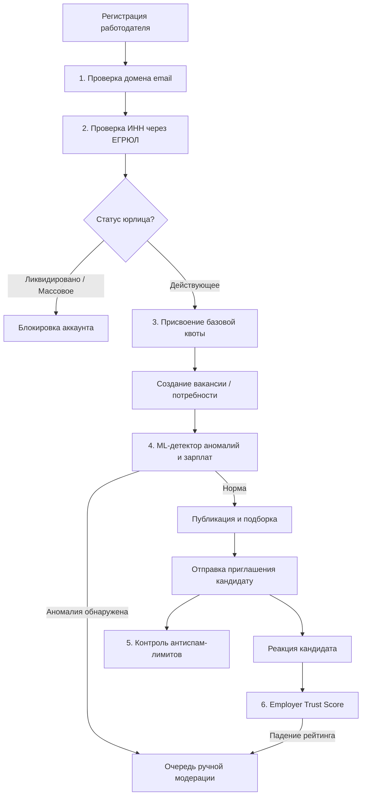
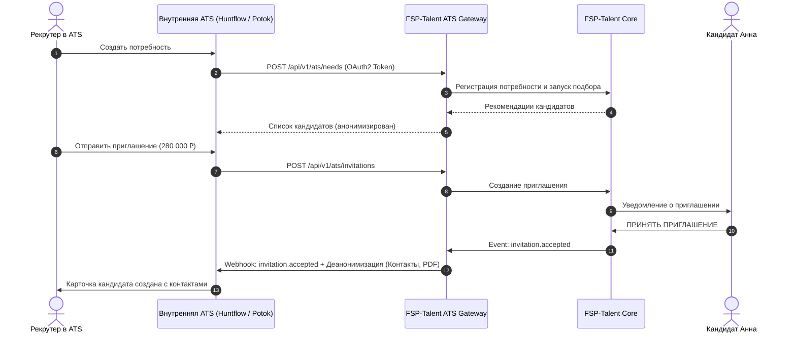
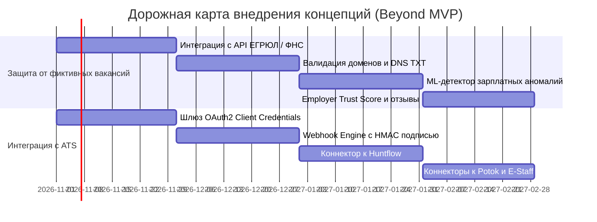

# Концепции развития за рамками MVP (Beyond MVP Concepts)

**Платформа:** FSP-Talent  
**Статус документа:** Обязательная сопроводительная документация по п. 2.1 и 3.4 ТЗ  
**Области:** 1. Защита от фиктивных вакансий и недобросовестных работодателей; 2. Интеграция с внутренними ATS-системами работодателей  
**Дата разработки:** Октябрь 2026 г.  

---

## Содержание

1. [Введение и целеполагание](#1-введение-и-целеполагание)
2. [Концепция защиты от фиктивных вакансий и недобросовестных работодателей](#2-концепция-защиты-от-фиктивных-вакансий-и-недобросовестных-работодателей)
   - [2.1. Актуальность проблемы и векторы атак](#21-актуальность-проблемы-и-векторы-атак)
   - [2.2. Комплексная модель верификации работодателей](#22-комплексная-модель-верификации-работодателей)
   - [2.3. Верификация юридических лиц через ЕГРЮЛ по ИНН/ОГРН](#23-верификация-юридических-лиц-через-егрюл-по-инногрн)
   - [2.4. Валидация корпоративного почтового домена](#24-валидация-корпоративного-почтового-домена)
   - [2.5. Антиспам-квоты и адаптивные лимиты приглашений](#25-антиспам-квоты-и-адаптивные-лимиты-приглашений)
   - [2.6. ML-детектор аномалий (зарплатные вилки и шаблоны)](#26-ml-детектор-аномалий-зарплатные-вилки-и-шаблоны)
   - [2.7. Репутационный скоринг компаний (Employer Trust Score)](#27-репутационный-скоринг-компаний-employer-trust-score)
   - [2.8. Архитектура очереди ручной модерации и SLA](#28-архитектура-очереди-ручной-модерации-и-sla)
3. [Концепция интеграции с корпоративными ATS-системами](#3-концепция-интеграции-с-корпоративными-ats-системами)
   - [3.1. Бизнес-цель и сценарии использования](#31-бизнес-цель-и-сценарии-использования)
   - [3.2. Архитектура интеграционного слоя (API First)](#32-архитектура-интеграционного-слоя-api-first)
   - [3.3. Авторизация и безопасность (OAuth2 Client Credentials)](#33-авторизация-и-безопасность-oauth2-client-credentials)
   - [3.4. Событийная модель (Webhooks и жизненный цикл)](#34-событийная-модель-webhooks-и-жизненный-цикл)
   - [3.5. Экспорт стандартизированного профиля кандидата](#35-экспорт-стандартизированного-профиля-кандидата)
   - [3.6. Маппинг воронок найма с российскими ATS (Huntflow, Potok, E-Staff)](#36-маппинг-воронок-найма-с-российскими-ats-huntflow-potok-e-staff)
4. [Дорожная карта реализации (Roadmap)](#4-дорожная-карта-реализации-roadmap)

---

## 1. Введение и целеполагание

Платформа **FSP-Talent** реализует обратную механику найма (Reverse Hiring): работодатели находят кандидатов по верифицированным категориям компетенций и отправляют адресные приглашения с прозрачной зарплатной вилкой.

В рамках MVP ключевой фокус был сделан на ядре платформы (адаптивное IRT-тестирование, алгоритм подбора, профили и приватность). Для масштабирования платформы в промышленную эксплуатацию критически важны два направления, сформулированные в **п. 2.1 ТЗ**:
1. **Защита сообщества от недобросовестных практик:** ограждение участников ФСП от фиктивных вакансий, спам-рассылок кадровых агентств, «серых» зарплатных предложений и сбора персональных данных.
2. **Бесшовная встраиваемость в бизнес-процессы:** интеграция с корпоративными Applicant Tracking Systems (ATS), исключающая ручной перенос данных рекрутерами крупных ИТ-компаний.

---

## 2. Концепция защиты от фиктивных вакансий и недобросовестных работодателей

### 2.1. Актуальность проблемы и векторы атак

На классических агрегаторах вакансий до 20–30% объявлений являются «фиктивными»:
- Сбор баз контактов кандидатов сторонними посредниками и инфобизнесом;
- Публикация «вакансий-призраков» для создания видимости роста компании или занижения рыночных ожиданий кандидатов;
- Несоответствие заявленной зарплаты реальному офферу (bait-and-switch);
- Спам массовыми нерелевантными приглашениями («ковровая рассылка»).

В модели FSP-Talent контакты кандидата скрыты до момента принятия им оффера. Однако недобросовестные игроки могут пытаться отправлять завышенные фиктивные офферы для деанонимизации разработчиков.

---

### 2.2. Комплексная модель верификации работодателей

Архитектура доверия FSP-Talent строится на 6 эшелонах валидации:



---

### 2.3. Верификация юридических лиц через ЕГРЮЛ по ИНН/ОГРН

Для получения статуса верифицированного работодателя компания обязана указать ИНН/ОГРН. Платформа осуществляет автоматизированную проверку через открытые API ФНС России (или сервисы Контур.Фокус / СПАРК):
1. **Статус правоспособности:** компания должна иметь статус `Действующее юридическое лицо` (исключаются организации в стадии ликвидации, банкротства или реорганизации).
2. **Срок деятельности:** компании моложе 3 месяцев попадают на расширенный контроль модератора.
3. **Реестры недобросовестных лиц:** проверка директора и учредителей по Реестру дисквалифицированных лиц (РДЛ) ФНС и проверка организации по Реестру недобросовестных поставщиков (РНП).
4. **Массовость адреса и руководителей:** отсев фирм-однодневок с массовыми адресами регистрации (более 10 компаний на адрес без признаков бизнес-центра).
5. **Соответствие ОКВЭД:** проверка наличия профильных кодов экономической деятельности (разработка ПО, информационные технологии, научные исследования и телекоммуникации).

---

### 2.4. Валидация корпоративного почтового домена

Для исключения регистрации анонимных аккаунтов вводятся жесткие правила доменной аутентификации:
1. **Запрет публичных почтовых провайдеров:** регистрация компаний с почтовых ящиков `@gmail.com`, `@mail.ru`, `@yandex.ru`, `@bk.ru`, `@inbox.ru` и одноразовых почтовых сервисов (temp-mail) запрещена на уровне валидации схемы.
2. **DNS-проверка домена:** верификация наличия валидных DNS-записей типа `MX` и `SPF` у домена компании.
3. **Подтверждение владения доменом:**
   - *Вариант А (базовый):* отправка верификационного письма на адрес `hr@company.ru` с одноразовым токеном;
   - *Вариант Б (Enterprise):* добавление проверочной DNS TXT-записи (`fsp-talent-verification=<UUID>`).

---

### 2.5. Антиспам-квоты и адаптивные лимиты приглашений

Чтобы предотвратить автоматизированный спам и защитить приватность кандидатов, внедряется система **динамических квот на исходящие приглашения**:

| Уровень доверия компании | Условия получения | Лимит приглашений в сутки | Лимит активных диалогов |
|---|---|:---:|:---:|
| **Новый работодатель (Unverified)** | Подтвержден только email | **3** приглашения / сутки | 5 |
| **Верифицированный (Verified)** | Пройден ЕГРЮЛ + корпоративный домен | **15** приглашений / сутки | 30 |
| **Проверенный партнер (Trusted)** | Trust Score $\ge 85\%$, более 5 принятых офферов | **50** приглашений / сутки | 100 |
| **Enterprise / Аккредитованная ИТ** | Прямой договор, интеграция с ATS | **Индивидуально** | Не ограничено |

#### Правила расходования квоты:
- При отклонении приглашения кандидатом квота **не восстанавливается** (дестимулирование нерелевантной рассылки);
- Если кандидат принимает приглашение, компания получает возврат 1 единицы квоты в качестве бонуса за высокое качество подбора.

---

### 2.6. ML-детектор аномалий (зарплатные вилки и шаблоны)

При создании потребности текст и финансовые условия анализируются фоновым сервисом модерации:
1. **Зарплатный аномализатор (Salary Outlier Detector):**
   - Платформа ведет динамическую матрицу медианных зарплат по категориям на основе подтвержденных офферов:
     
     $$\text{Median}(C, G) \pm 2\sigma$$
     
   - Если указанная зарплата «от» превышает рыночную медиану на $\ge 2.5\sigma$ (например, Джуниору предлагается 500 000 ₽) - потребность помечается как подозрительная (риск фишинга);
   - Если указанная зарплата «до» ниже МРОТ или неадекватно занижена для грейда - отправка блокируется до исправления.
2. **Анализ текстовых дубликатов (LSH / MinHash):**
   - Детекция копипасты шаблонных описаний вакансий с внешних досок объявлений;
   - Выявление спам-маркеров («доход от 1000$ в день», «работа без опыта 2 часа в день», ссылки на подозрительные Telegram-боты).
3. **Защита от запросов неоплачиваемых объемных тестовых заданий:**
   - NLP-детектор запрещает публикацию требований «выполнить тестовое задание до первого интервью, срок выполнения от 3 дней».

---

### 2.7. Репутационный скоринг компаний (Employer Trust Score)

Каждому работодателю присваивается динамический индекс доверия $\text{TrustScore} \in [0; 100]$:

$$\text{TrustScore} = 40 \cdot R_{\text{accept}} + 30 \cdot R_{\text{speed}} + 20 \cdot R_{\text{reviews}} + 10 \cdot R_{\text{profile}}$$

где:
- $R_{\text{accept}}$ - доля принятых кандидатами приглашений (отсутствие спама);
- $R_{\text{speed}}$ - скорость ответа рекрутера после принятия приглашения кандидатом (штраф за задержку первого контакта свыше 48 часов);
- $R_{\text{reviews}}$ - оценка от кандидатов по итогам выхода на контакт (короткий опрос: «Соответствовала ли реальная зарплата заявленной в оффере?», «Было ли общение корректным?»);
- $R_{\text{profile}}$ - полнота заполнения профиля компании и подтверждение статуса аккредитованной ИТ-компании Минцифры РФ.

> При падении $\text{TrustScore} < 50$ аккаунт автоматически приостанавливает отправку новых приглашений и направляется на расследование в службу безопасности.

---

### 2.8. Архитектура очереди ручной модерации и SLA

Подозрительные события направляются во внутренний интерфейс суперадминистратора платформы:
- **Триггеры эскалации:** 
  * Жалоба кандидата на нарушение условий оффера;
  * Срабатывание детектора аномалий зарплаты;
  * Массовый отказ кандидатов с формулировкой «Нерелевантный спам».
- **SLA модерации:** ручной разбор инцидента сотрудником ФСП в течение **4 рабочих часов**.
- **Действия модератора:** вынесение предупреждения, принудительное замораживание квоты, перманентный бан юридического лица и его домена.

---

## 3. Концепция интеграции с корпоративными ATS-системами

### 3.1. Бизнес-цель и сценарии использования

Крупные работодатели (Сбер, Т-Банк, Яндекс, Ростелеком, VK) ведут весь пайплайн подбора в специализированных ATS (Applicant Tracking Systems). Ручной перенос данных из сторонних агрегаторов снижает конверсию и замедляет наем.

Интеграционный шлюз **FSP-Talent ATS Connector** решает следующие задачи:
1. Автоматический импорт одобренных кандидатов в ATS компании в статус «Новый лид / Первичное интервью»;
2. Двусторонняя синхронизация статусов (когда кандидат проходит интервью или получает оффер в ATS, платформа обновляет внутренний трекинг);
3. Автоматическая публикация потребностей из ATS на платформу FSP-Talent.

---

### 3.2. Архитектура интеграционного слоя (API First)



---

### 3.3. Авторизация и безопасность (OAuth2 Client Credentials)

Для серверного взаимодействия между ATS работодателя и платформой FSP-Talent применяется протокол **RFC 6749 (OAuth 2.0 Client Credentials Grant)**:
1. В личном кабинете работодателя выпускается пара ключей:
   - `client_id` (публичный идентификатор интеграции);
   - `client_secret` (секретный ключ, отображаемый однократно).
2. ATS запрашивает краткоживущий токен доступа (Bearer Token):
   ```http
   POST /api/v1/auth/oauth/token HTTP/1.1
   Host: api.fsp-talent.ru
   Content-Type: application/x-www-form-urlencoded

   grant_type=client_credentials
   &client_id=fsp_client_89a3f120
   &client_secret=sec_98f712abcd45...
   &scope=ats:candidates:read ats:invitations:write ats:webhooks
   ```
3. Сервер возвращает подписанный JWT с временем жизни (TTL) 3600 секунд.

---

### 3.4. Событийная модель (Webhooks и жизненный цикл)

Все ключевые изменения статусов передаются в ATS в реальном времени через механизм **Webhooks**.

#### Реестр событий:
- `need.matched` - сформирована новая подборка кандидатов под потребность;
- `invitation.sent` - приглашение отправлено кандидату;
- `invitation.viewed` - кандидат открыл и прочитал условия оффера;
- `invitation.accepted` - **ключевое событие:** кандидат принял оффер, передаются полные персональные данные и контакты;
- `invitation.declined` - кандидат отклонил приглашение (передается обезличенная причина);
- `application.received` - кандидат самостоятельно откликнулся на открытую вакансию компании.

#### Гарантии доставки и безопасность Webhook:
- **Криптографическая подпись (HMAC-SHA256):** каждый запрос сопровождается заголовком `X-FSP-Signature: sha256=...`, вычисляемым от тела запроса с использованием секретного ключа вебхука.
- **Защита от Replay-атак:** заголовок `X-FSP-Timestamp` с валидацией временного окна $\le 300$ секунд.
- **Политика повторных попыток (Retry Policy):** при недоступности эндпоинта ATS (ответы $5xx$ или timeout) платформа выполняет экспоненциальный откат (Exponential Backoff): 1 мин, 5 мин, 30 мин, 2 часа, 24 часа.

---

### 3.5. Экспорт стандартизированного профиля кандидата

При срабатывании события `invitation.accepted` платформа формирует два артефакта:

#### 1. Структурированный JSON-объект карточки кандидата
```json
{
  "event": "invitation.accepted",
  "candidate": {
    "candidate_id": "cand_a1b2c3d4",
    "full_name": "Анна Смирнова",
    "email": "anna.smirnova@example.com",
    "phone": "+7 (999) 123-45-67",
    "telegram": "@anna_smirnova_dev",
    "category": {
      "specialization": "BACKEND",
      "grade": "MIDDLE",
      "grade_confirmed": true,
      "cat_score_theta": 1.45,
      "percentile": 87.2
    },
    "verified_skills": [
      {"name": "Python", "source": "ASSESSMENT_TEST", "confidence": 1.0},
      {"name": "FastAPI", "source": "ASSESSMENT_TEST", "confidence": 1.0},
      {"name": "PostgreSQL", "source": "RESUME_VERIFIED", "confidence": 0.85}
    ],
    "fsp_profile": {
      "fsp_id": "FSP-RUS-77-2024-0412",
      "sports_category": "Кандидат в мастера спорта (КМС)",
      "rating": 1840,
      "tournaments_count": 8,
      "best_result": "2 место, Чемпионат Москвы по спортивному программированию 2025"
    },
    "accepted_offer": {
      "invitation_id": "inv_99887766",
      "salary_from": 250000,
      "salary_to": 300000,
      "currency": "RUB",
      "accepted_at": "2026-10-06T15:30:00Z"
    }
  }
}
```

#### 2. Стандартизированный брендированный PDF-профиль
Автоматически сгенерированный одностраничный документ формата А4 в фирменной палитре ФСП, содержащий:
- Цифровой паспорт компетенций;
- Радарную диаграмму по темам тестирования;
- Верифицированные олимпиадные достижения;
- **Криптографический QR-код** со ссылкой на публичную страницу проверки валидности профиля на портале `fsp-talent.ru/verify/<HASH>`.

---

### 3.6. Маппинг воронок найма с российскими ATS (Huntflow, Potok, E-Staff)

Для интеграции с лидирующими российскими HR-платформами разработана таблица сопоставления этапов жизненного цикла:

| Этап в платформе FSP-Talent | Huntflow (Хантфлоу) API | Potok (Поток) API | E-Staff Рекрутер |
|---|---|---|---|
| **Кандидат найден в подборке** | `Лид (Новый)` | `Холодный пул` | `Начальный отбор` |
| **Приглашение отправлено** | `Отправлено предложение` | `Ждем ответа соискателя` | `Приглашен на контакт` |
| **Приглашение принято** | `Принято (Первичное интервью)` | `Согласие получено` | `Назначено собеседование` |
| **Приглашение отклонено** | `Отказ кандидата` | `Отказ` | `Отклонено соискателем` |
| **Оффер от работодателя** | `Выставлен оффер` | `Оффер` | `Предложение о работе` |
| **Кандидат нанят** | `Вышел на работу` | `Нанят` | `Оформлен в штат` |

#### Готовые коннекторы (Out-of-the-box Adapters):
1. **Huntflow Adapter:** интеграция через REST API v2 (`/applicants`, `/vacancies/{id}/applicants`). Автоматическое создание кандидата с прикреплением PDF-резюме и тегами `FSP-Talent`, `Middle-Confirmed`.
2. **Potok Adapter:** взаимодействие через Webhook-подписку и OpenAPI сопоставление этапов воронки.
3. **E-Staff XML/JSON Bridge:** поддержка файлового и сокет-обмена для локально развернутых систем E-Staff в закрытых корпоративных сетях.

---

## 4. Дорожная карта реализации (Roadmap)



### Фаза 1 (Q4 2026): Базовый траст и открытый API
- Запуск интеграции с сервисом проверки контрагентов ФНС (ЕГРЮЛ по ИНН);
- Внедрение OAuth2 Client Credentials для корпоративных партнеров;
- Запуск Webhooks по базовым событиям (`invitation.accepted`, `invitation.declined`).

### Фаза 2 (Q1 2027): Готовые коннекторы и ML-безопасность
- Релиз коробочных интеграций для Huntflow и Potok;
- Запуск алгоритма репутационного скоринга компаний Employer Trust Score;
- Внедрение зарплатного аномализатора на базе исторических данных найма хакатона и ФСП.

### Фаза 3 (Q2 2027): Федеративное доверие и Enterprise E-Staff
- Интеграция с ЕСИА / Госуслугами для верификации уполномоченных представителей юридических лиц;
- Коннектор для E-Staff и кастомных self-hosted ATS;
- Публичный реестр добросовестных работодателей-партнеров Федерации спортивного программирования.
