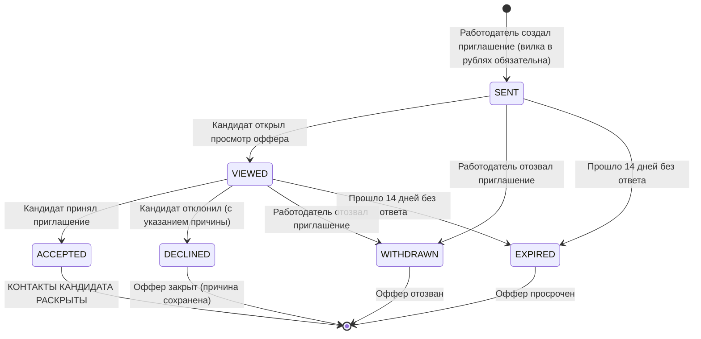

# Бизнес-логика, математические модели и алгоритмы

В данном документе детально разобраны ключевые алгоритмы платформы **FSP-Talent**, на которые приходится **60% баллов** оценки хакатона, актуализированные в соответствии с решениями сессии **Q&A от 06.10.2026** (имеющими безусловный приоритет над ТЗ).

---

## 1. Обратная механика найма (Reverse Hiring Mechanics) - 35% оценки

Традиционные площадки поиска работы (HeadHunter, SuperJob) заставляют кандидата откликаться «вслепую» на вакансии без четких требований и вилок, а работодатели тонут в сотнях нерелевантных резюме.

### Принцип FSP-Talent:
1. **Инициатива исходит от работодателя:** Кандидат не рассылает резюме, а проходит стандартизированную верификацию квалификации.
2. **Обязательная зарплатная вилка в рублях:** Работодатель не может отправить приглашение со скрытой зарплатой или формулировкой «по договоренности». В приглашении **обязательны** `salary_from` и `salary_to` в рублях (с явным указанием гросс или нетто).
3. **Сокрытие контактов до согласия:** Работодатель изучает объективные метрики и стек кандидата, не видя его персональных данных. Контакты открываются только тогда, когда кандидат изучил условия и нажал «Принять».
4. **Отказ от парсинга чужих вакансий (Q&A п. 32, 91):** Платформа не является агрегатором спаршенных объявлений. Фокус сделан на прямую и честную коммуникацию соискателя и работодателя внутри платформы.

```
                     ┌───────────────────────────────────┐
                     │ Описание потребности работодателя │
                     └─────────────────┬─────────────────┘
                                       │
                                       ▼
                     ┌───────────────────────────────────┐
                     │   Двухэтапный подбор кандидатов   │
                     │  (Этап 1: Пул, Этап 2: Ранжир)    │
                     └─────────────────┬─────────────────┘
                                       │
                                       ▼
                     ┌───────────────────────────────────┐
                     │   Анонимизированная карточка      │
                     │ (Баллы, перцентиль, стек, ФСП)    │
                     └─────────────────┬─────────────────┘
                                       │
                                       ▼
                     ┌───────────────────────────────────┐
                     │ Приглашение с обязательной вилкой │
                     │   (от > 0, до >= от в рублях)     │
                     └─────────────────┬─────────────────┘
                                       │
                       Кандидат видит условия оффера
                                       │
                     ┌─────────────────┴─────────────────┐
                     │                                   │
                     ▼                                   ▼
          [ Принято кандидатом ]              [ Отклонено кандидатом ]
                     │                                   │
         Контакты кандидата раскрыты!          Фиксация причины для аналитики
```

---

## 2. Механика квалификационного тестирования: CAT и 2PL IRT (25% оценки)

В соответствии с Q&A (п. 22, 85):
- Первичный квалификационный тест строится **строго под категорию** (IT-направление: Backend, Frontend, QA, Data/ML, DevOps), а не под конкретную вакансию.
- Присвоенный грейд видит работодатель как независимый ориентир. Достижения ФСП на грейд не влияют.
- Кандидат **самостоятельно выбирает заявляемый грейд**, а тест его подтверждает или не подтверждает (подсказка по резюме допустима).

### 2.1. Математическая модель 2PL IRT
Вероятность правильного ответа кандидата со способностью $\theta$ на задание $i$ с параметром дискриминативности $a_i$ и трудности $b_i$:

$$P_i(\theta) = \frac{1}{1 + \exp\bigl(-a_i \cdot (\theta - b_i)\bigr)}$$

- $\theta \in [-3.0, +3.0]$ - скрытая способность кандидата (уровень квалификации);
- $b_i \in [-3.0, +3.0]$ - калиброванная сложность задания;
- $a_i \ge 0.5$ - дискриминативность задания (способность разделять сильных и слабых кандидатов).

### 2.2. Оценка способности $\theta$ методом EAP (Expected A Posteriori)
После каждого ответа текущая способность кандидата $\hat{\theta}$ оценивается методом математического ожидания апостериорного распределения с априорным нормальным распределением $\mathcal{N}(\theta_0, \sigma_0^2)$, центрированным на заявленный грейд ($\theta_0$ от $-1.0$ до $+2.0$):

$$\hat{\theta} = \frac{\int \theta \cdot L(\mathbf{u} | \theta) \cdot \pi(\theta) \, d\theta}{\int L(\mathbf{u} | \theta) \cdot \pi(\theta) \, d\theta}$$

Где правдоподобие серии ответов $\mathbf{u} = (u_1, \dots, u_k)$:
$$L(\mathbf{u} | \theta) = \prod_{i=1}^k P_i(\theta)^{u_i} \cdot \bigl(1 - P_i(\theta)\bigr)^{1 - u_i}$$

Интеграл вычисляется методом квадратур Гаусса–Эрмита по сетке от $-4.0$ до $+4.0$ с шагом $0.1$.

### 2.3. Информационная функция Фишера и выбор следующего вопроса
Информация, которую задание $i$ несет об испытуемом со способностью $\theta$:

$$I_i(\theta) = a_i^2 \cdot P_i(\theta) \cdot \bigl(1 - P_i(\theta)\bigr)$$

**Алгоритм выбора (`Randomesque Top-5`):**
1. Отбираются не показанные ранее кандидату семейства заданий, соответствующие балансу тем (blueprint).
2. Вычисляется $I_i(\hat{\theta})$ для каждого семейства.
3. Среди 5 заданий с максимальной информацией Фишера случайным образом выбирается одно (рандомизация защищает от идентичных тестов у кандидатов одного уровня).
4. Проверяется лимит экспозиции: после первых 15 сессий специализации семейство, показанное более чем в $25\%$ её сессий, исключается из выбора, пока остаётся хотя бы 5 других.

### 2.4. Устойчивость банка заданий и защита от списывания
В соответствии с п. 28, 62 Q&A одинаковые задачи **не расходятся между кандидатами**:
- Каждое задание принадлежит параметрическому изоморфному семейству (`item-family`);
- При формировании задания передается уникальный числовой `seed`, генерирующий уникальные переменные, фрагменты кода и правильный ответ;
- Утечка ответа бессмысленна: следующий кандидат с тем же вопросом получит другие числовые значения и другой правильный вариант;
- Валидация банка (`make bank-check`) гарантирует отсутствие подсказок по форме вариантов (длина ответа, числа в условии).

### 2.5. Правила остановки и определение грейда
- **Пороги грейдов (cut-scores):** Стажёр $-1.5$, Junior $-0.5$, Middle $+0.5$, Senior $+1.5$.
- **Длина теста:** от 12 до 25 заданий; тест завершается раньше 25, когда $\text{SE}(\hat{\theta}) < 0.30$.
- **Политика подтверждения и неподтверждения грейда (Q&A п. 24, 99):**
  - $\hat{\theta} \ge \text{cut\_score}$ - грейд подтверждён, категория присвоена;
  - $\hat{\theta} - \text{SE} \ge \text{next\_cut\_score}$ - кандидату предлагается пройти короткий бесплатный тест на грейд выше (повышение отдельным тестом, без автопрыжка);
  - $\hat{\theta} < \text{cut\_score}$ - **грейд не подтверждён**. В профиле выставляется статус «Не подтверждён». Принудительного понижения нет. Кандидату предлагается короткий тест на грейд ниже.
- **Политика попыток и кулдаун (Q&A п. 27, 103):**
  - Первичное определение: до 3 попыток за 7 дней с первой сессии;
  - Короткий тест на соседний грейд (8–15 заданий) доступен 24 часа без сжигания попытки;
  - После успешного подтверждения смена грейда блокируется на **90 дней** (`next_grade_change_available_at`), предотвращая хаотичные скачки;
  - Неудачная попытка сдать тест на более высокий грейд **не снижает текущий подтвержденный грейд**.

### 2.6. Экспресс-тест для экспертного жюри (Q&A п. 171)
Для быстрой ручной проверки разделяющей силы теста экспертами жюри предусмотрен экспресс-режим:
- 5 калиброванных заданий с высокой дискриминативностью ($a_i \ge 1.5$);
- Время прохождения: 3–5 минут;
- Динамическая демонстрация: правильный ответ сразу повышает сложность на уровень выше, неверный - снижает;
- Интерактивный вывод кривой $\theta$ и погрешности $\text{SE}$.

---

## 3. Двухэтапный подбор и ранжирование (Matching)

Ранжирование строится по **объективно подтвержденным категориям**, а не по ключевым словам резюме.

### Этап 1: Формирование пула (Hard Filtering)
Кандидат попадает в пул, если:
1. Его статус поиска активен (`status != 'HIDDEN'`).
2. Совпадает категория (целевая, соседний грейд $\pm 1$, либо смежная специализация).
3. Минимальная ожидаемая зарплата не превышает бюджет работодателя (`desired_salary_min <= budget_max`).
4. Формат работы (удаленка, офис, гибрид) совместим с запросом.

### Этап 2: Объяснимая формула скоринга (Soft Ranking)

$$\text{Score} = 0.30 \cdot C + 0.25 \cdot S + 0.10 \cdot E + 0.25 \cdot T + 0.07 \cdot F + 0.03 \cdot A$$

| Компонент | Вес | Описание | Значения |
|---|---|---|---|
| **$C$ (Category)** | 0.30 | Соответствие категории | $1.0$ (точное), $0.6$ ($\pm 1$ грейд или неподтвержденный грейд), $0.4$ (смежная спец.) |
| **$S$ (Stack)** | 0.25 | Покрытие требуемого стека с весом верификации | $1.0$ (подтвержден тестом/ФСП), $0.5$ (из резюме), $0.3$ (заявлен) |
| **$E$ (Semantic)** | 0.10 | Семантическое сходство описания потребности и профиля | $0.0 \dots 1.0$ (Jaccard / e5-small embeddings) |
| **$T$ (Test)** | 0.25 | Процентиль результата теста: $\Phi(\hat{\theta})$ по модели популяции $\mathcal{N}(0, 1)$ | $0.0 \dots 1.0$ |
| **$F$ (FSP)** | 0.07 | Верифицированный балл ФСП | $0.0 \dots 1.0$ (**0.0 при отсутствии истории**) |
| **$A$ (Activity)** | 0.03 | Актуальность профиля | $1.0$ (активен), $0.7$ (открыт к предложениям) |

### Механика работы с неподтверждённым грейдом (Q&A п. 24, 99):
- Кандидат с неподтверждённым грейдом **НЕ исключается из поисковой выдачи** работодателя.
- В карточке отображается бейдж **«Грейд не подтверждён»**.
- Компонент соответствия категории $C$ умножается на понижающий коэффициент $0.6$ (соответствует уровню смежного грейда).
- Кандидат опускается в выдаче относительно подтвержденных специалистов, но остается доступным для адресных приглашений от компаний, готовых растить джуниоров.

### Защита от дискриминации кандидатов без истории ФСП:
Балл $F$ работает как **бонус, а не штраф**. Вес $F$ ($0.07$) подобран так, что кандидат с высоким результатом теста ($T = 0.95$) без участия в спортивном программировании ($F = 0$) гарантированно займет более высокую позицию, чем кандидат со слабым тестом ($T = 0.20$), даже обладающий достижениями ФСП ($F = 1.0$). Это подтверждено автоматическими тестами абляции (`test_no_fsp_candidate_never_penalized_and_ablation`).

---

## 4. Скоринг достижений Федерации спортивного программирования (FSP-Score)

В соответствии с п. 141 Q&A:
> **«Ранжировать дисциплины не надо: все соревнования равно важны, внутренний рейтинг „чемпионат России выше хакатона“ давать не советуют. Дисциплины ФСП имеют равную ценность, упор на победы/призы и активность, без доминирования одной дисциплины над другой.»**

Балл спортивных достижений рассчитывается по формуле взвешенной суммы с временным затуханием:

$$\text{RawScore} = \sum_{j} \Bigl(\text{Level}_j \times \text{Result}_j \times \text{Discipline}_j \times \text{Decay}_j\Bigr) + \text{SportCategoryBonus}$$

### Веса компонентов:
- **Дисциплина ($\text{Discipline}$):** **Равный вес 1.0 для всех официальных дисциплин ФСП**:
  - Продуктовое программирование: $1.0$
  - Алгоритмическое программирование: $1.0$
  - Программирование систем информационной безопасности: $1.0$
  - Программирование робототехники: $1.0$
- **Результат ($\text{Result}$):** Упор на победы и призы:
  - Победитель (Winner / 1st place): $1.0$
  - Призёр (Prize winner / 2nd-3rd place): $0.75$
  - Финалист (Finalist): $0.5$
  - Участник (Participant): $0.2$ (защита от накрутки профиля одними онлайн-явками)
- **Уровень турнира ($\text{Level}$):**
  - Международный: $1.0$
  - Всероссийский: $0.8$
  - Межрегиональный: $0.5$
  - Региональный: $0.3$
  - Городской: $0.2$
- **Временное затухание ($\text{Decay}$):** $\exp(-0.22 \times \Delta t)$ с периодом полураспада ~3.15 года (свежие победы котируются выше архива).
- **Бонус за спортивный разряд ($\text{SportCategoryBonus}$):**
  - МСМК: $+0.35$
  - Мастер спорта (МС): $+0.25$
  - Кандидат в мастера спорта (КМС): $+0.15$
  - 1 разряд: $+0.10$
  - 2 разряд: $+0.05$

Нормализация в диапазон $[0, 1]$ осуществляется по логарифмической шкале с калибровочной константой $\text{MaxExpectedScore} = 2.40$ (соответствует 2 всероссийским победам + КМС):
$$\text{FSP-Score} = \min\left(1.0, \, \frac{\ln(1 + \text{RawScore})}{\ln(1 + \text{MaxExpectedScore})}\right)$$

---

## 5. Конечный автомат приглашений (Invitations FSM)



### Правила конечного автомата:
1. **Переходы строго однонаправленные:** Нельзя перейти из терминальных состояний (`ACCEPTED`, `DECLINED`, `WITHDRAWN`, `EXPIRED`).
2. **Обязательная причина при отказе:** При переходе в `DECLINED` кандидат обязан указать одну из стандартных причин (`SALARY`, `TECH_STACK`, `FORMAT`, `NOT_LOOKING`, `OTHER`).
3. **Раскрытие контактов строго в `ACCEPTED`:** Никакой другой статус не дает работодателю доступа к телефону, email или Telegram соискателя (152-ФЗ).

---

## 6. Гибридный парсинг вакансий (AI-First с детерминированным NLP-фолбэком)

Для снижения порога входа работодателей реализован интеллектуальный парсер неструктурированного текста вакансий (`POST /api/v1/needs/parse`).

### 6.1. Архитектура гибридного конвейера
1. **Первичный контур (GigaChat AI, 152-ФЗ):**
   - Текст запроса анализируется отечественной LLM GigaChat (ПАО Сбербанк). Модель извлекает специализацию (`BACKEND`, `FRONTEND`, `QA`, `DATA_ML`, `DEVOPS`, `MOBILE`), грейд (`JUNIOR`, `MIDDLE`, `SENIOR`, `LEAD`), формат работы (`REMOTE`, `HYBRID`, `OFFICE`), город, опыт в годах, зарплатную вилку (`salary_from`, `salary_to`) и флаг `is_gross`.
2. **Семантическая канонизация стека:**
   - Извлечённые свободные названия технологий нормализуются с очисткой служебных слов и сопоставляются с эталонным справочником 360+ IT-навыков ФСП (`SKILLS_DATA`) по точным совпадениям, синонимам и подстрокам.
3. **Отказоустойчивый резервный контур (Deterministic Rule NLP):**
   - Если GigaChat недоступен, превышен таймаут (>12 сек) или стенд запущен в автономном контуре без доступа к внешней сети, система мгновенно переключается на алгоритмический анализатор `need_parser.py`.
   - Анализатор использует синтаксические маркеры русского языка, лемматизацию окончаний, весовую модель ролей (заголовок $W=3.0$, текст $W=1.0$, теги навыков $W=0.5$) и регулярные выражения для зарплат и формата.
4. **Прозрачность источника разбора:**
   - В ответе возвращаются метаданные `parser_source` (`"gigachat"` или `"rule_based"`), `ai_available` и `engine_badge`, которые отображаются работодателю в интерфейсе перед запуском подбора.

