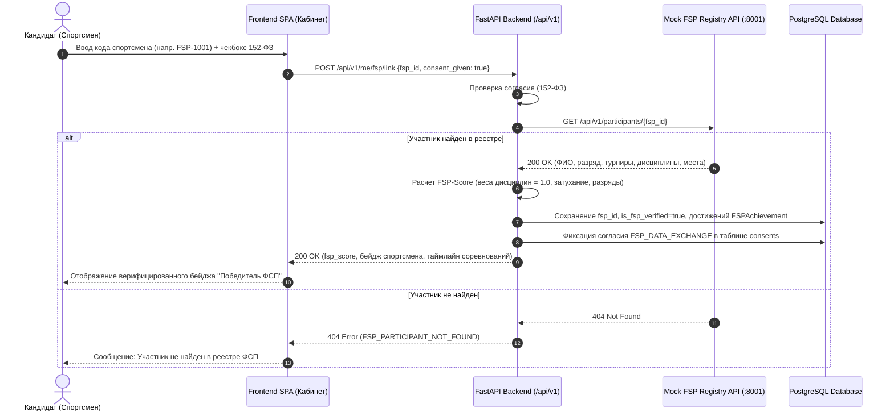

# ADR 003: Стратегия аутентификации, OIDC и интеграция с ФСП ID

## Статус
Принято (Accepted). Актуализировано по результатам установочной сессии Q&A от 06.10.2026 (п. 34–35, 133–137), имеющим высший приоритет над ТЗ.

## Контекст
ТЗ требует регистрацию по email, безопасное разграничение ролей (кандидат / работодатель), связку с ФСП ID и демонстрацию входа через ФСП ID.
На сессии Q&A организаторы дали прямые разъяснения:
1. Боевые доступы к инфраструктуре ФСП и закрытому Keycloak командам **не предоставляются**.
2. Сам сервис FSP ID находится на этапе становления, архива соревнований мало, описания API нет.
3. Развертывание реального промышленного Keycloak в `docker-compose.yml` **не требуется** жюри и избыточно утяжеляет проверку.
4. Достаточно **реалистичной имитации привязки и скелета будущей OIDC-интеграции** на собственных структурированных данных.

## Решение

### 1. Архитектурный режим по умолчанию (Jury Staging / Compose / Local Dev):
- В платформу встроен легковесный, полностью совместимый JWT Auth Provider (`AUTH_PROVIDER=internal`), реализующий эндпоинты `/api/v1/auth/register`, `/api/v1/auth/login`, `/api/v1/auth/refresh`.
- Интеграция с ФСП ID реализована через автономный микросервис **Mock FSP Registry** (`services/fsp-mock`, порт 8001), предоставляющий REST API к реестру спортсменов, протоколам соревнований, дисциплинам и спортивным разрядам.
- Привязка FSP ID выполняется через эндпоинт `/api/v1/me/fsp/link` с обязательным согласием субъекта ПДн по 152-ФЗ. При успешной верификации профиль связывается с FSP ID, рассчитывается `FSP-Score` по утвержденной формуле с равными весами дисциплин (1.0), а токен пользователя обогащается клеймом `fsp_id`.

---

### 2. Целевая архитектура промышленного подключения (Enterprise OIDC Identity Brokering):
Для боевого развертывания в контуре Федерации спроектирована схема подключения через Keycloak OpenID Connect Broker:
- Keycloak выступает в качестве Identity Broker между публичным шлюзом платформы и корпоративным сервером единой авторизации Федерации (FSP SSO).
- Авторизация SPA выполняется по протоколу **OAuth 2.0 Authorization Code Flow с PKCE**.
- При федеративном логине Keycloak запрашивает UserInfo у поставщика идентификации ФСП, извлекает спортивный идентификатор и добавляет claim `fsp_id` в стандартный Access/ID Token (JWT).
- Бэкенд FSP-Talent валидирует входящий JWT токен по публичному ключу JWKS Keycloak и прозрачно считывает клеймы `sub`, `email`, `role`, `fsp_id`.

```mermaid
flowchart TD
    subgraph Users ["Пользователи"]
        User["Кандидат / Спортсмен"]
    end

    subgraph PlatformFrontend ["Клиентская часть"]
        SPA["Frontend React SPA"]
    end

    subgraph IAM ["Контур идентификации (Keycloak)"]
        KC["Keycloak 24+ (Identity Broker)"]
        Realm["Realm: fsp-talent"]
        ClientApp["Client: fsp-frontend (PKCE)"]
    end

    subgraph ExternalFSP ["Внешняя инфраструктура ФСП"]
        FSP_SSO["Корпоративный FSP ID (OIDC Provider)"]
        FSP_DB[("Единый реестр спортсменов ФСП")]
    end

    subgraph PlatformBackend ["Серверная часть FSP-Talent"]
        API["FastAPI Backend"]
        DB[("PostgreSQL 16")]
    end

    User -->|1. Клик 'Войти через FSP ID'| SPA
    SPA -->|2. Redirect с PKCE Challenge| KC
    KC -->|3. OIDC Brokering Redirect| FSP_SSO
    User -->|4. Ввод учетных данных ФСП| FSP_SSO
    FSP_SSO -->|5. Auth Code + UserInfo| KC
    KC -->|6. Обогащение JWT клеймом fsp_id| KC
    KC -->|7. Redirect с Auth Code| SPA
    SPA -->|8. Exchange Code -> JWT Token| KC
    SPA -->|9. API запрос с Bearer JWT| API
    API -->|10. JWKS валидация токена| KC
    API -->|11. Чтение профиля по fsp_id| DB
```

---

### 3. Разграничение прав доступа (RBAC & Object Ownership)
- **Кандидат (`role = CANDIDATE`):** Доступ к собственному профилю, сессиям адаптивного тестирования, привязке FSP ID, просмотру входящих офферов и акцепту/отклонению приглашений.
- **Работодатель (`role = EMPLOYER`):** Доступ к профилю компании, созданию потребностей (вакансий), запуску подбора кандидатов. Контакты кандидатов физически скрыты до акцепта приглашения (`ACCEPTED`).
- **Администратор (`role = ADMIN`):** Мониторинг экспозиции семейств заданий, аудит раскрытия персональных данных.

## Последствия
1. **Соответствие вердикту Q&A:** Стенд жюри запускается мгновенно без тяжелого Java-контейнера Keycloak, не потребляя лишние гигабайты оперативной памяти.
2. **Бесшовная масштабируемость:** Контракт токенов и claims унифицирован, переключение на боевой Keycloak в будущем требует изменения единственной переменной окружения `AUTH_PROVIDER=keycloak`.
3. **Строгое соблюдение 152-ФЗ:** Интеграция с реестром требует явного отдельного согласия, а пароли пользователей никогда не передаются в открытом виде.
