# ER-модель данных платформы FSP-Talent (v1)

Диаграмма сущностей базы данных отражает реляционные связи модульного монолита, поддерживая все ключевые требования ТЗ: анонимизацию контактов, строгие переходы состояний приглашений, адаптивное тестирование IRT/CAT, достижения ФСП и сохранение снимков подборок.

```mermaid
erDiagram
    USERS ||--o| CANDIDATE_PROFILES : has
    USERS ||--o{ CONSENTS : signs
    USERS ||--o{ AUDIT_LOGS : triggers
    USERS ||--o{ EMPLOYER_MEMBERS : belongs_to

    COMPANIES ||--o{ EMPLOYER_MEMBERS : employs
    COMPANIES ||--o{ NEEDS : publishes
    COMPANIES ||--o{ INVITATIONS : sends
    COMPANIES ||--o{ VACANCIES : posts

    CANDIDATE_PROFILES ||--o{ CANDIDATE_SKILLS : possesses
    CANDIDATE_PROFILES ||--o{ ASSESSMENT_SESSIONS : takes
    CANDIDATE_PROFILES ||--o{ GRADE_HISTORY : has
    CANDIDATE_PROFILES ||--o{ FSP_ACHIEVEMENTS : achieved
    CANDIDATE_PROFILES ||--o{ INVITATIONS : receives
    CANDIDATE_PROFILES ||--o{ SHORTLIST_ITEMS : included_in

    DIRECTIONS ||--o{ SPECIALIZATIONS : contains
    SPECIALIZATIONS ||--o{ CATEGORIES : forms
    GRADES ||--o{ CATEGORIES : defines
    SKILLS ||--o{ SKILL_SYNONYMS : has
    SKILLS ||--o{ CANDIDATE_SKILLS : referenced_in

    ITEM_FAMILIES ||--o{ SESSION_ITEMS : generates
    ASSESSMENT_SESSIONS ||--o{ SESSION_ITEMS : contains

    NEEDS ||--o{ SELECTION_SNAPSHOTS : creates
    SELECTION_SNAPSHOTS ||--o{ SHORTLIST_ITEMS : pins
    NEEDS ||--o{ INVITATIONS : referenced_in

    USERS {
        uuid id PK
        string email UK
        string password_hash
        string role "CANDIDATE | EMPLOYER | ADMIN"
        boolean is_active
        boolean email_verified
        datetime created_at
    }

    CONSENTS {
        uuid id PK
        uuid user_id FK
        string consent_type "PERSONAL_DATA | PROFILE_DISTRIBUTION"
        string version
        boolean is_given
        datetime given_at
        datetime revoked_at
    }

    CANDIDATE_PROFILES {
        uuid id PK
        uuid user_id FK, UK
        string first_name
        string last_name
        string phone
        string telegram
        string fsp_id "Идентификатор ФСП"
        string status "ACTIVELY_SEARCHING | OPEN | HIDDEN"
        string confirmed_category "Specialization x Grade"
        string confirmed_specialization
        string confirmed_grade
        float last_theta "Оценка способности IRT"
        float last_se "Погрешность SE"
        integer category_percentile "Процентиль в категории"
        float fsp_score "0..1 нормированный балл"
        integer desired_salary_min "Ожидаемая зарплата"
        string work_format "REMOTE | HYBRID | OFFICE"
        string city
        boolean is_fsp_verified
        boolean hide_contacts_globally
        datetime next_grade_change_available_at
        datetime updated_at
    }

    CANDIDATE_SKILLS {
        uuid id PK
        uuid candidate_profile_id FK
        uuid skill_id FK
        string confirmation_source "CLAIMED | RESUME | ASSESSMENT | FSP"
        float weight
    }

    ITEM_FAMILIES {
        uuid id PK
        string code UK
        string specialization
        string target_grade
        string topic
        string item_format "CODE_OUTPUT | CODE_ERROR | SQL | COMPLEXITY | MCQ"
        float discrimination_a "Параметр a (IRT 2PL)"
        float difficulty_b "Параметр b (IRT 2PL)"
        integer exposure_count
        boolean is_active
        string template_yaml
    }

    ASSESSMENT_SESSIONS {
        uuid id PK
        uuid candidate_profile_id FK
        string specialization
        string target_grade
        float current_theta
        float current_se
        string status "IN_PROGRESS | COMPLETED | TIMED_OUT | FLAGGED"
        integer items_count
        datetime started_at
        datetime finished_at
    }

    SESSION_ITEMS {
        uuid id PK
        uuid session_id FK
        uuid item_family_id FK
        integer seed
        string rendered_question
        string user_response
        boolean is_correct
        float response_time_seconds
        datetime presented_at
    }

    COMPANIES {
        uuid id PK
        string name
        string inn
        string website
        string description
        string logo_url
        boolean is_verified
    }

    NEEDS {
        uuid id PK
        uuid company_id FK
        string title
        string raw_description
        string target_specialization
        string target_grade
        json required_skills
        integer salary_budget_min
        integer salary_budget_max
        string work_format
        datetime created_at
    }

    SELECTION_SNAPSHOTS {
        uuid id PK
        uuid need_id FK
        string query_filters_hash
        json ranked_candidates_payload
        datetime created_at
    }

    INVITATIONS {
        uuid id PK
        uuid company_id FK
        uuid candidate_profile_id FK
        uuid need_id FK
        string status "SENT | VIEWED | ACCEPTED | DECLINED | WITHDRAWN | EXPIRED"
        integer salary_from "Обязательно в рублях"
        integer salary_to "Обязательно в рублях"
        string message
        string contact_method
        string decline_reason "SALARY | TECH_STACK | FORMAT | NOT_LOOKING"
        datetime sent_at
        datetime viewed_at
        datetime resolved_at
        datetime expires_at "14 дней"
    }

    FSP_ACHIEVEMENTS {
        uuid id PK
        uuid candidate_profile_id FK
        string event_name
        datetime event_date
        string discipline "Спортивное программирование / Продуктовое и т.д."
        string level "REGIONAL | INTERREGIONAL | ALL_RUSSIAN | INTERNATIONAL"
        string result "WINNER | PRIZE_WINNER | FINALIST | PARTICIPANT"
        string sport_category "КМС | Мастер спорта | 1 разряд"
        float calculated_weight
    }
```

