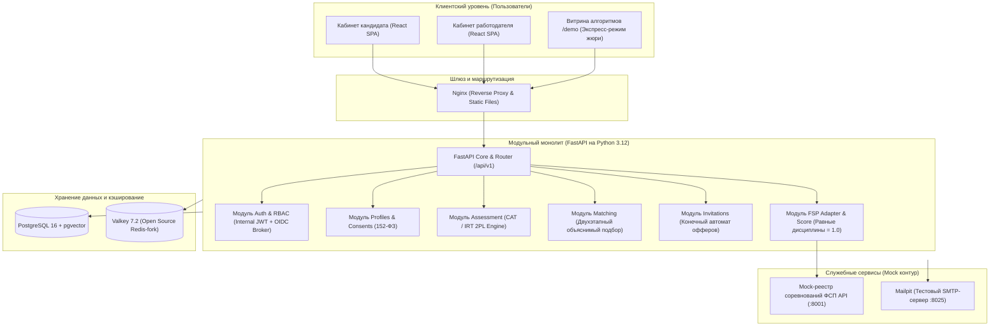

# Обзор системной архитектуры FSP-Talent

Данный документ содержит структурный обзор компонентов платформы **FSP-Talent**, актуализированный в соответствии с решениями сессии **Q&A от 06.10.2026** (имеющими безусловный приоритет над ТЗ).

---

## 1. Схема взаимодействия компонентов

---

## 2. Ключевые механизмы безопасности и приватности (152-ФЗ)

### 2.1. Механизм сокрытия контактов (Contact Anonymization)
- По умолчанию кандидат в выдаче работодателя отображается в виде анонимизированной карточки.
- Поля `email`, `phone`, `telegram`, а также текущее место работы и ФИО скрываются до тех пор, пока:
  1. Работодатель не отправит приглашение с гарантированной вилкой заработной платы `salary_from` и `salary_to` в рублях;
  2. Кандидат явно не примет данное приглашение (`status = ACCEPTED`).
- Либо альтернативный сценарий: кандидат самостоятельно откликается на опубликованную вакансию компании.
- Вся выдача профилей фильтруется через Pydantic-схему `CandidateProfileAnonymizedResponse`, которая физически отсекает приватные поля на уровне сериализации.

### 2.2. Защита от списывания и устойчивость банка заданий (Q&A п. 28, 62)
1. **Изоморфные семейства заданий:** Каждый вопрос генерируется динамически по уникальному числовому `seed`. Одинаковые задачи не расходятся между кандидатами, так как меняются входные данные, код и логика правильного ответа.
2. **Адаптивный алгоритм (CAT 2PL IRT):** Кандидаты получают разные наборы заданий, выбираемые по максимуму информационной функции Фишера с рандомизацией top-5 (`randomesque`).
3. **Контроль экспозиции:** Экспозиция каждого семейства строго ограничена (не более 25% сессий).
4. **Валидация банка (`make bank-check`):** Статическая проверка устраняет подсказки по форме вариантов (длина правильного ответа, повторяющиеся числа).
5. **Поведенческий антифрод:** Фиксация переключения вкладок браузера, копирования в буфер обмена и аномального времени реакции.

### 2.3. Равенство дисциплин ФСП и защита кандидатов без спортивной истории (Q&A п. 141)
- Все 4 официальные спортивные дисциплины ФСП имеют **равный вес (1.0)**:
  - Продуктовое программирование: 1.0;
  - Алгоритмическое программирование: 1.0;
  - Программирование систем информационной безопасности: 1.0;
  - Программирование робототехники: 1.0.
- Достижения ФСП дают дополнительный положительный коэффициент `FSP-score` к ранжированию внутри категории, но **не присваивают грейд автоматически**.
- При отсутствии истории ФСП балл равен 0 (бонус, а не штраф).
- Кандидат с высоким результатом тестирования без истории ФСП всегда ранжируется выше кандидата со слабым тестом, даже имеющего дипломы. Это подтверждено автоматическими тестами абляции.

### 2.4. Политика неподтвержденного грейда (Q&A п. 24, 99)
- При непрохождении порога выбранного грейда кандидат **НЕ исключается** из поиска.
- Профиль помечается бейджем «Грейд не подтверждён» и опускается в поисковой выдаче (штрафной коэффициент $0.6$ к компоненту категории $C$).
- Это сохраняет кандидата в активном обороте рынка труда.

### 2.5. Соответствие стенду жюри (Q&A п. 41, 172)
- Ориентир стенда: 32–64 ГБ RAM, ~8 CPU, **БЕЗ GPU**.
- Все компоненты системы (FastAPI, PostgreSQL 16 + pgvector, Valkey 7.2) оптимизированы под CPU-инференс, потребляя суммарно менее 1 ГБ оперативной памяти.
